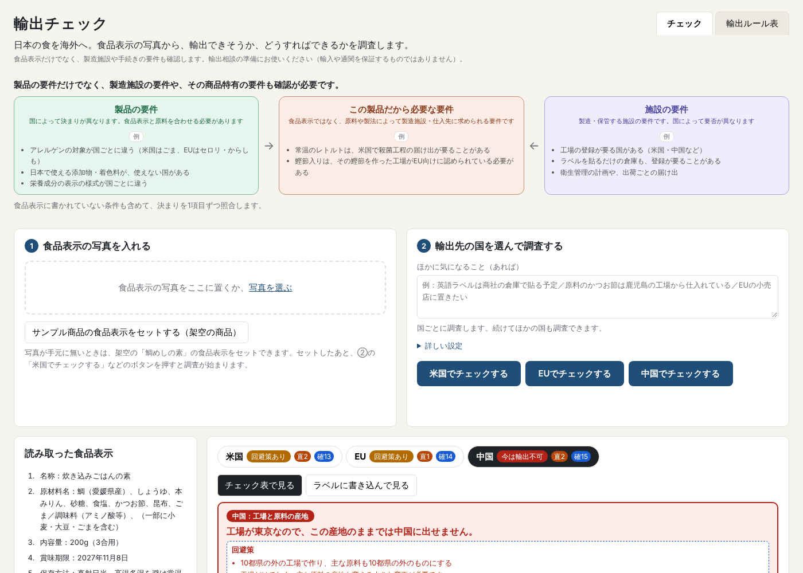

# 和食の渡し舟｜この食品、輸出できる？ どうすればできる？

チーム：輸出チェック

このプロジェクトは、日本の食品を海外に届けたい人の「輸出できるのか、どうすればできるのか分からない」という課題を、AIの答えをプログラムが確かめ、商品設計の段階で道筋と次の一歩が分かる形に変える、ブラウザの道具です。

**食品メーカー1社の約100商品を調べると、約4割に、米国か EU へ出す前に確かめることがありました。** 輸出を考えるなら、商品設計から見直すことになる場合もあります。大きく動き出す前に分かれば、選べる道が残ります。



▶ [デモ動画（3分）を見る](https://youtu.be/Ni29CA_0HCA)

> 日本の食は、世界に誇れるものだと思っています。私の会社でも、添加物の少ない、丁寧に作った食品なら、表示を英語にすれば海外に出せると考えていました。
>
> ところが、米国 FDA の査察で初めて、だし入りの炊き込みご飯の素が米国では「低酸性食品」にあたり、常温では製造施設の登録と殺菌条件の届け出が要ると知りました。食品商社を通していたにもかかわらず、知らないまま、危ない橋を渡っていたのです。その商品の米国向けはやめましたが、別の商品は米国向けだけ冷蔵にして、今も輸出を続けています。
>
> 日本の食品は独特で、海外のルールに引っかかる所があります。それは作り手の努力が足りないからではなく、知る機会が無いからだと思います。
>
> この道具は、初めて輸出を任された担当者や、「表示を英語にすれば出せる」と思っている営業の方が、大きく動き出す前に「輸出できるか、どうすればできるか」を知るために作りました。日本の食文化を、もっと世界に知ってもらうために。試しに使う商品にも、日本らしい炊き込みご飯の素（架空の「お出汁が効いた鯛めしの素」）を選びました。
>
> ― 作者（食品メーカーで表示と輸出に関わってきました）

## AIの苦手なところを、仕組みで補う

チャットのAIに日本のお菓子の食品表示を見せて「問題ないか」と聞くと、「問題は見当たりません」と答え、表示が必須の原料原産地（重さで一番多い原料の産地）の抜けを見落としました。AIは、書いてある物は確かめても、**無い欄は、聞かれなければ出てこないことがあります**。

だから聞くのをやめ、133項目を一つずつ全部当てはめる形にしました。

- **輸出ルール表の全項目を当てはめる**：Claude と米国・EU・中国の約60の公的資料（法令、当局の Q&A、JETRO など公的機関の解説、農水省・厚労省・水産庁の輸出の要綱、日本から持ち出す時の決まり）を読み込み、輸出で止まる所を133項目にまとめた輸出ルール表（2026年11月時点）の全項目に、Claude が「ある／無い／対象外／分からない」を付け、根拠を引用します。
- **抜けはプログラムが埋める**：答えの無い項目は「分からない」で埋め、pH や産地のように数字や地名で決まる項目は判定表で決めます。
- **引用を照合する**：引用した文が食品表示と輸出ルール表に本当にあるかを確かめ、無ければ「確認が必要」に下げます。

一般に流通している食品25件で各項目に正解を付けて測り、**見落とし（正解が「引っかかる」なのに「ある」「対象外」と答えた項目）はありませんでした**（379項目中369項目が一致、97%）。作者の会社の約100商品でも、**社内で見直した結果と一致しました**（くわしくは「答え合わせ」）。

## 3か国で、引っかかる所が違う

| 国 | 見せ場 | 鯛めしの素（架空）の見立て |
|---|---|---|
| 米国 | 缶詰・瓶詰・レトルトの区分（低酸性／酸性化／冷蔵冷凍／対象外）。常温のまま届け出る道と、米国向けだけ冷蔵にする道を並べる | 回避策あり：常温のレトルトなので、製造施設の登録と殺菌条件の届け出が要るかを確かめる |
| EU | 動物由来の原料は、認められた施設の物だけ | 回避策あり：かつお節を作った施設がEU向けに認められているかを確かめる |
| 中国 | 製造施設の登録と、主原料の産地（10都県の停止は登録とは別に効く） | 今は輸出不可：製造者が東京都（10都県の一つ）。最終加工地が10都県なら、今の決まりでは入口で止まる |

見立ては「製品の要件／この製品だから必要な要件／施設の要件」の三つに分けて出します。本当に怖いのは、商品と製造施設の間に落ちる「この製品だから必要な要件」です。

## 最新の決まりへの追いつき方

輸出の決まりは、毎年のように変わります。輸出チェックは、判断の物差しをプログラムの中に埋め込まず、`rules/輸出ルール表.md` という一つの表にまとめています。

- **1項目ごとに出どころと施行日を持たせています。** 出どころは、農林水産省・米国食品医薬品局（FDA）・欧州委員会などの当局のページと、JETRO など公的機関の解説です。確かめ方も【原文】【当局ページ】【二次】【要照合】の印で分けています。
- **画面に確認日を出しています。** いつ時点の決まりで調べたかが分かります。
- **施行日がまだ先の決まりも扱います。** これから変わる決まりは、その旨を示します。
- **見直しは月に1回を予定しています。** 食品の安全に関わるルールは、頻繁に変わるものではなく、決まってから実際に効くまでに猶予があるのがふつうです。たとえば WTO の SPS 協定では、加盟国は新しい措置を案の段階で通報し、公表から施行までに、通常6か月以上の間を置くことになっています。月1回の見直しなら、施行の前に表へ入れられます。ただし、緊急の輸入停止のように、すぐ効く措置もあります。そうした知らせは、農林水産省や JETRO の速報で別に追います。 出どころのページを開いて前回との違いを探し、変わった所を Claude が下書きにします。下書きは人が確かめてから表に入れ、確認日を新しくします。AI が単独で表を書き換えることはしません。
- **プログラムを直す必要はありません。** 表の形（`#` 列＋6列、`## 国`、`### 箱`）を変えなければ、表を直すだけで次のチェックから反映されます。

**実際に、古い情報を見つけて直した例**：中国向け加工食品の産地について、2021年の農林水産省のページには「最終加工地が10都県の外であれば、主原料が10都県産でなければよい」という形で書かれていました。2026年9月28日時点の農林水産省の Q&A を確かめたところ、最終加工地が10都県であれば、主原料が10都県の外でも証明書は発行されないこと、主原料の産地が分からない場合は輸入が認められないことが分かりました。輸出ルール表は新しい資料に合わせ、古い資料には古い旨を書き添えています。

## しくみ

```
食品表示の写真 ─▶ ① 読む係（Claude）……… 文字を一字一句書き写す。判定はしない
                    │
輸出ルール表 ──▶ ② 当てはめ係（Claude）… 国×要件ごとに、表の全項目を判定
（Markdownの表）     │                      ・根拠の表示の文字と表の文を、そのまま引用させる
                    ▼
               ③ プログラム ………………… ・返ってこなかった項目は「分からない」で埋める（返った答えの中の漏れはゼロ）
                                          ・数字や地名で決まる項目は判定表で決める
                                            （中国の10都県、米国の pH 4.6 × 水分活性 0.85）
                                          ・根拠チェック：引用が表示と表に本当にあるか照合し、
                                            合わなければ「確認が必要」に下げる
                    ▼
               ④ 画面 ……………………………… 見立てと次の一歩／分かれば決まることの聞き返し
                                          相談文をコピーして Claude に続きを頼むボタン
```

**判断の手助けです**。出荷の前に、項目ごとの出典と窓口（JETRO など）で必ず確かめてください。

## Claude の使い方

- アプリの中では、Claude を「読む係」と「当てはめる係」に分け、答えの形を決めて全項目に答えさせ、プログラムが確かめます。
- 作る過程では、クラウドの Claude Code が指揮者になり、設計・実装・資料調べ・答え合わせを分けて進めました。
- ハッカソンの後のために、ルール表の見直し用の Skill・サブエージェント・フックをリポジトリに入れました（アプリの判定には使いません）。

**アプリの中で**

- **役割を2つに分けています。** ① 食品表示の写真を一字一句書き写すだけの係（判定はしない）と、② 輸出ルール表を1項目ずつ当てはめる係です。読み違いと判断の誤りを分けて確かめられます。
- **答えの形を決めています。** JSON の形（structured outputs）を指定して受け取り、全項目に答えさせます。根拠は食品表示とルール表の文をそのまま引用させ、プログラムが照合します。
- **モデルの機能を目的で選んでいます。** 写真の読み取りには画像入力、判定には考える量を調整できる設定（adaptive thinking と effort）、何度も同じ長い指示を渡す所にはプロンプトキャッシュを使っています。
- **API キーが無くても動きます。** Claude Code にログインしていれば、同じ指示と写真を `claude -p`（`--json-schema` 付き）に渡して判定します。

**作る過程で：クラウドの Claude が指揮者になりました**

作者が主にやり取りする相手は、クラウドで動く Claude Code の1人です。プログラミングの初心者である作者がしたのは、食品表示と輸出の決まりを知っている者として答えを確かめることだけで、設計・実装・資料調べ・答え合わせの段取りは、クラウドの Claude Code が指揮者になって分けました。

- **ルール表は Claude が約60の公的資料を読んで下書きし、作者が確かめました。** 各項目に出典と確認の度合いを付けさせ、古い資料を見つけた時は新しい資料に合わせました。
- **サブエージェントで裏取りしました。** ルール表の下書きのあと、サブエージェント4本を並行して走らせ、① JETRO・農林水産省の相談事例、② 日本の食品会社あての FDA 警告書とその後の流れ、③ 判断が割れた項目の一次資料、④ 書類が法令の要求か商慣行か、を調べさせました。
- **答え合わせを回しながら直しました。** API キーを使わずに Claude Code（`claude -p`）で判定できるようにして、11/4〜11/6 にアプリから639回呼び、558回で判定が返りました。残り81回は週あたりの利用上限に当たって返らず、上限が明けてから走らせ直しました。最初の見落とし5件のうち、4件はルール表の整え方で消え、1件は正解そのものが間違っていました。
- **ほかの AI と議論させて磨きました。** 作者の PC の Claude Code（Remote Control で動かしました）と他社の AI を、審査員役や「初めて輸出を任された担当者」役にして、画面の言葉や提出文を講評させました。他社の AI につなぐ仕組みは、プログラミング初心者の作者には作れませんでした。そこで、作者の PC の Claude にブラウザを操作させ、人と同じように画面から話しかけてもらいました。指揮者の Claude が議長になり、出た指摘をぶつけ合わせました。採用する修正は作者が決めました。
- **プルリクエストで取り込みました。** クラウドの Claude が自分でブランチを切ってプルリクエストを作り、作者が中身を見てから取り込みました（例：PR #1）。作者の会社の商品情報集めと画面の確かめには、Claude in Chrome を使いました。
- **仕事はスレッドに分けて並行して進め、共有のメモで話をそろえました。**

**このリポジトリに入れた Skill・サブエージェント・フック**

ハッカソン最終日（11/7）に入れた、ハッカソンの後にルール表を月1回見直すための仕組みです（「最新の決まりへの追いつき方」）。アプリの判定には使いません。

- **Skill** [`.claude/skills/rule-table-review`](.claude/skills/rule-table-review/SKILL.md)：「ルール表を見直して」と頼むと、直し案の下書きを `rules/見直し/` に書いて、そこで止まります。人が確かめるまで表は書き換えません。
- **サブエージェント** [`.claude/agents/rule-source-checker.md`](.claude/agents/rule-source-checker.md)：国ごとに1本ずつ並行して動き、項目の出どころのページを開いて、今の文をそのまま引用し「変化なし／変化あり／開けなかった」を返します。書き込む道具は持たせていません。開けなかった時は、変化なしと決めつけません。
- **フック** [`.claude/settings.json`](.claude/settings.json)：ルール表を書き換えた時だけ `npm test` を流し、表の形が崩れていたら Claude に知らせて直させます。

11/7 に、中国の7項目で試しに動かしました（[下書き](rules/見直し/2026-11-07_試行_中国.md)）。中身の変化はありませんでしたが、この仕組みが表の穴を見つけました。根拠の Q&A の URL が表に書かれておらず、サブエージェントが開けなかったのです。ほかに出どころの書き方の直しが2か所ありました。作者が確かめたうえで、同じ日に表を直しました。

## ハッカソンの後

- **新商品の企画と輸出相談で、まず当たりを付けます。** 作者の会社で、輸出を検討する時の最初の確認に使います。
- **国を増やします。** 今回は、引っかかる所が多く判断の難しい米国・EU・中国を取り上げました。ルール表は国ごとに同じ形で書いているので、ほかの国も同じやり方で足していきます。
- **ルール表を月1回見直します**（上の「最新の決まりへの追いつき方」）。

## 動かし方

必要なもの：[Node.js](https://nodejs.org/) 22 以上と、次のどちらか一つ。

- **A. Claude の API キー**（ご自身の鍵をお使いください。作者の鍵は入っていません）

  ```bash
  npm install
  cp .env.example .env      # .env を開いて ANTHROPIC_API_KEY= の後ろに鍵を書く
  npm start                 # http://localhost:3000 を開く
  ```

- **B. Claude Code**（`claude` コマンドにログイン済みなら、API キーは要りません）

  ```bash
  npm install
  CLAUDE_BACKEND=claude-code npm start    # http://localhost:3000 を開く
  ```

鍵が無くても、`npm test` と画面の「輸出ルール表」タブは動きます。

画面は動かしているパソコンからだけ開けます（同じネットワークの他の機器から鍵を使われないため）。他の機器から開きたい時は `HOST=0.0.0.0 npm start` で起動してください。

## 答え合わせ（正解つきの試験）

```bash
npm run eval              # eval/cases/ の試験ケースをすべてチェックにかけて点数を出す
npm test                  # 鍵なしで確かめられる所の試験（表の読み込み・判定表・根拠チェック）
```

リポジトリに入れている試験ケース `eval/cases/*.json` は、架空の商品4件（鯛めしの素 tai-01 ほか）です。正解は輸出ルール表の項目番号ごとに「ある／無い／対象外／分からない」で書きます。いちばん大事な数字は **見落とし**（正解は「無い」なのに「ある」「対象外」と言った項目の数）です。

### 結果

下の2つは実在の商品で確かめたため、データ・社名・商品名は公開していません。

答え合わせは、ルール表が127項目だった時点（11/6）のものです。11/7 に国内資料と突き合わせて6項目を足しました（[点検の記録](rules/見直し/2026-11-07_国内資料の点検.md)）。

**一般に流通している食品25件**：各項目に正解を付けて測り、見落としはありませんでした（379項目中369項目が一致、97%）。

作り始めの1回目は見落としが5件ありました。4件はルール表の整え方で消え、1件は正解そのものが間違っていました。

- EU のアレルゲンの強調表示（3件、ルール表の整え方で解消）：EU の現地語のラベルで求められる決まりで、日本語の表示には要りません。今は「輸出用のラベルに足す物」として必ず示します。
- 米国の魚の名前のかっこ書き（1件）：ルール表の整え方で解消しました。
- 米国の原産国の表示（1件）：正解そのものが間違っていました（正解の側の理由が空欄でした）。

一致しなかった残りの10項目は、確認に回したもの3、言い過ぎ1、ずれ6です。このうち3件は、正解が「確かめが要る」なのに、道具が大丈夫な側に答えていました。次の見直しで直します。

**作者の会社の約100商品（98件）**：上の整理のあとに初めてかけた商品です。結果は、社内で輸出に向けて見直した結果と一致しました。米国か EU で確かめることが出たのは約4割（41件）でした。

- 米国 23件：常温のレトルト 17、煮干しを使ったちりめん 4、鶏肉入り 2
- EU 37件：動物由来の原料
- 中国：会社のサイトに原料の産地が載っていないため、数えていません

## 作り方について

- 輸出ルール表は、Claude が公的資料を調べて下書きし、食品メーカーで表示と輸出に関わってきた作者が確かめて決めました。コードは Claude Code と一緒に書きました。
- 判定には Claude を使いますが、Claude の記憶には規則を任せません。根拠は輸出ルール表の項目だけです。
- 画面・試験ケース・画像に出てくる商品・会社・住所はすべて架空です。

## English summary

Export Check helps small Japanese food makers see, before shipping, whether a product can be exported to the US, EU and China, and what to do next.
A chat AI checks what is written on a label, but a missing field may not come up unless you ask about it. So instead of asking, the tool applies all 133 items one by one.
So Claude applies every item of a sourced export rule table (133 items drawn from about 60 official sources, including JETRO guides) to the label and quotes its evidence; the program fills unanswered items with "unknown", decides numeric items (pH, water activity, origin) with fixed tables, and verifies every quote.
On 25 commercially available foods with item-level answer keys, it missed nothing (369 of 379 items matched). On about 100 of the author's own company products, checked for the first time after the rule table was tidied up, the results matched the company's internal review.
All products, companies and addresses shown in this repository are fictional.

## ライセンス

[MIT License](LICENSE)
